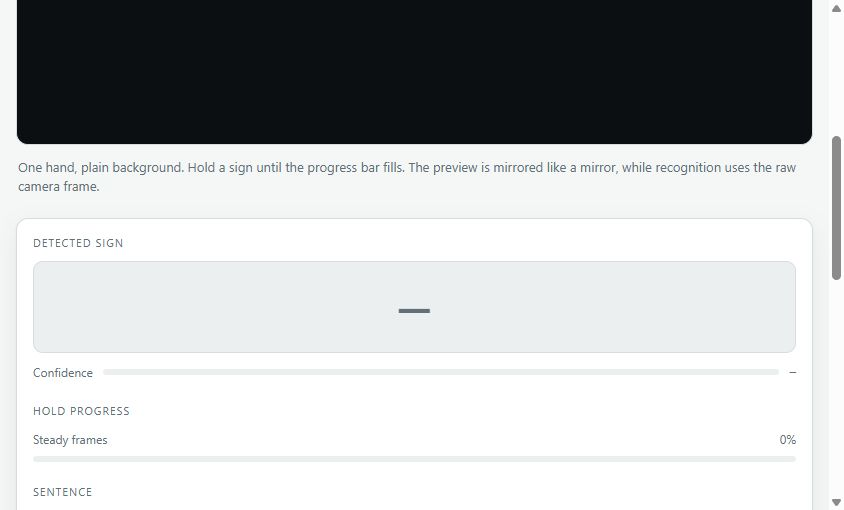

# ASL sign language recognition

 [](LICENSE)

Reads 36 American Sign Language signs (A to Z, 0 to 9) from a webcam feed. Two ways to run it:

- `inference_classifier.py` opens a live desktop window and builds a sentence as you sign.
- `asl_live.html` runs the exported model in the browser. The page loads `model.onnx` automatically, with a file picker as fallback.

## Who is this for

Students learning fingerspelling, computer vision developers who want a small MediaPipe and SVM example, and anyone who wants a real time ASL recognition demo that runs in a browser without an install.

## Live demo

https://dinsesh-builds.github.io/asl-sign-language/



The camera step needs webcam access in your browser. The model and MediaPipe steps load on their own.

## Run on desktop

Use Python 3.9 or newer. From the repository root:

```bash
pip install -r requirements.txt
python inference_classifier.py
```

On Windows, text to speech uses SAPI when available. Elsewhere it falls back to `pyttsx3`, which is optional:

```bash
pip install pyttsx3
```

Keys in the live window: `space` ends a word, `s` speaks the sentence, `t` toggles speech, `f` toggles letter feedback, `backspace` deletes a character, `c` clears, `q` quits.

## How it works

1. `collect_imgs.py` captures hand images for each of the 36 classes.
2. `create_dataset.py` converts hand landmarks into 63 scale invariant features (normalised x and y for 21 landmarks, plus the distance of each landmark to the wrist) and writes `data.pickle`.
3. `train_classifier.py` augments the data, makes a stratified 80/20 split, searches SVM parameters with 5 fold cross validation, then writes `model.p` and prints a classification report.
4. `export_model.py` writes `model.onnx` for the browser.
5. `inference_classifier.py` reads the webcam and uses a 7 frame majority buffer before appending a letter.

## Verify the result

```bash
python train_classifier.py
```

The script prints test accuracy and a per class report. The 80/20 split happens before augmentation, so near duplicates cannot inflate the test score. This README does not claim a fixed accuracy number. Run it on your own data to get yours.

## Limits

- One hand at a time, detection confidence 0.75, tracking confidence 0.65. Point the palm at the camera against a plain background.
- Touching fingers and self occlusion confuse landmark tracking, so pointing at one item can be read as another. The preview is mirrored while recognition uses the raw frame, so what you see and what the model reads differ by design.
- J and Z need motion in real ASL. This model treats them as static poses and will confuse them with similar letters.
- Trained on a controlled dataset. Lighting, camera angle, and hand size change the result. Median filtering and the hold bar reduce brief misreads but cannot fix bad landmarks.
- The browser path needs ONNX runtime and MediaPipe scripts from a CDN.
- This is a learning and prototyping tool, not a production accessibility product. The page has light and dark themes.

## Files

| File | Role |
| --- | --- |
| `collect_imgs.py` | Capture images per sign |
| `create_dataset.py` | Landmarks to features, writes `data.pickle` |
| `train_classifier.py` | Trains the SVM, writes `model.p`, prints metrics |
| `export_model.py` | Writes `model.onnx` for the browser |
| `inference_classifier.py` | Webcam demo with sentence building and speech |
| `asl_live.html` | Browser demo |
| `labels.json` | Label map |

## Related work

- [SplitGuard](https://github.com/dinsesh-builds/splitguard), the tool that found near duplicates in this dataset. It reported 416 of 2155 test rows with a near duplicate in train.
- [WLASL](https://github.com/dxli94/WLASL), the WACV 2020 word level dataset and method comparison. It covers 2,000 signs from video, so its scores are not comparable to this fingerspelling model, but it is the benchmark to read next.
- [sign-language-processing](https://github.com/kevinjosethomas/sign-language-processing), ASL fingerspelling with semantic pose retrieval.
- [SignLanguage](https://github.com/Narottam04/SignLanguage), a platform for learning ASL with videos for over 20,000 phrases.
- [Mediapipe and CNNs for Real-Time ASL Gesture Recognition](https://arxiv.org/pdf/2305.05296), a comparison of landmark classifiers.

## License

MIT. See [LICENSE](LICENSE).
